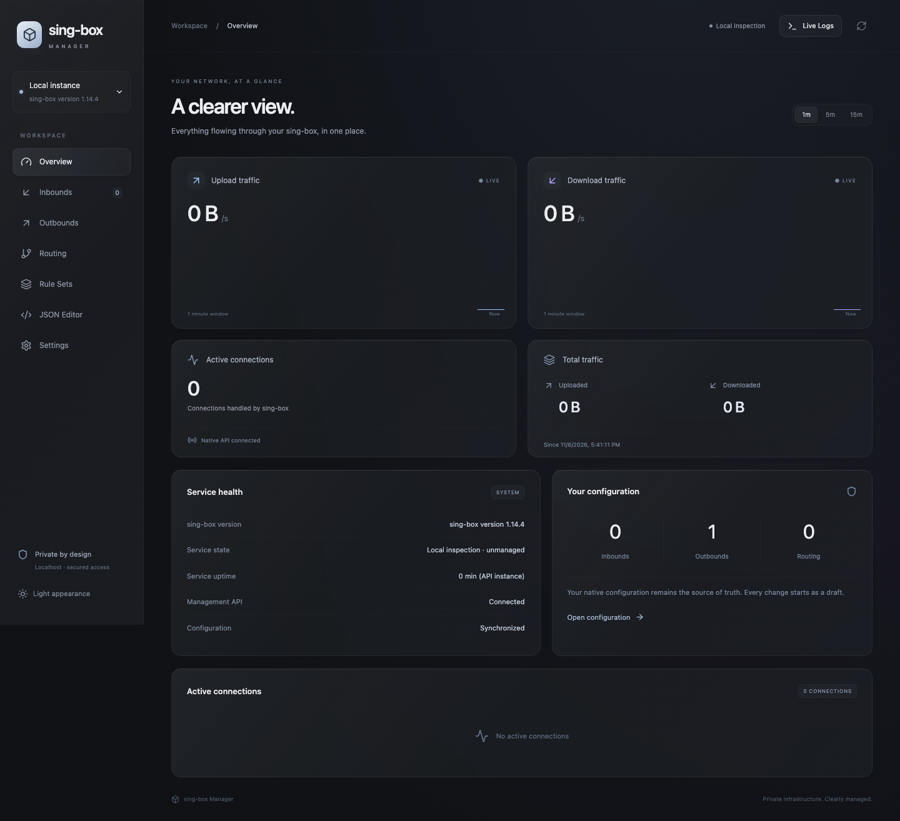

# sing-box Manager

A private, single-binary web manager for existing sing-box installations. React and a translucent desktop/mobile interface sit above a Go backend, native sing-box 1.14 gRPC monitoring, journald streaming, schema-driven configuration editors, and recoverable configuration deployments.

**Status:** locally built and tested software, with release automation prepared. No GitHub release or production installation is implied. See [verification](docs/verification.md) for executed checks and remaining limitations.



[Mobile preview](docs/screenshots/overview-mobile.png) · [Light appearance](docs/screenshots/overview-light.png)

## What it does

- Overview with one-second native proxy traffic, 1/5/15-minute charts, connection details, service information and explicit unavailable states.
- Inbound/outbound forms generated from the installed binary's schema; routing rules, ordered logical groups, rule sets, shared native JSON model, Monaco editing and diffs.
- Persistent drafts, conflict detection, installed-binary validation, backups, apply, service/listener/API health checks and automatic rollback. History restores become drafts.
- Live bounded, searchable, filterable journal logs with pause, copy, export and local buffer clearing.
- Loopback listener beginning at port 5030, automatic bounded fallback through 5099, persisted selection and instance locking.
- Non-root HTTP process; separate narrow root helper over a restricted Unix socket. Authentication and browser origin protection.
- Existing installation discovery, conservative read-only handling of ambiguous or multiple sources, embedded frontend, Debian/Ubuntu installer, private Tailscale Serve setup and release packaging.

## Local development

Requirements: Go matching `backend/go.mod`, Node.js 22.12+ (Node 26 also tested), npm, and a sing-box 1.14 binary for schema/check/monitoring. Linux production requires systemd; macOS development can inspect, edit drafts and validate an isolated configuration without modifying system services.

```sh
npm --prefix frontend ci
npm --prefix frontend run build
mkdir -p .local
printf '{"inbounds":[],"outbounds":[{"type":"direct","tag":"direct"}]}' > .local/config.json
cd backend
go run ./cmd/manager serve --local --state-dir ../.local/state \
  --config "$PWD/../.local/config.json" --sing-box /absolute/path/to/sing-box
```

Open the loopback URL printed by Manager (normally `http://127.0.0.1:5030`). Read the access token from `.local/state/token` in a local terminal and enter it in the login form. Tokens are never compiled into the UI. `--local` deliberately disables apply/restart; it supports real binary schema generation and configuration checks.

For frontend hot reload, run `npm --prefix frontend run dev` in another terminal while the Go server is listening on 5030. Vite proxies API requests to the backend; production uses one embedded origin.

```sh
npm --prefix frontend run lint
npm --prefix frontend run typecheck
npm --prefix frontend test
(cd backend && go test -race ./...)
python3 tests/installer_test.py
# Optional real binary integration (loopback/temporary fixtures only):
(cd backend && SING_BOX_BIN=/absolute/path/to/sing-box go test -race -v ./...)
```

## Production build

```sh
bash scripts/build.sh
bash scripts/package.sh v0.1.0
```

Outputs: `artifacts/manager` for the build host; `artifacts/sing-box-manager-v0.1.0-linux-amd64.tar.gz`, `artifacts/sing-box-manager-v0.1.0-linux-arm64.tar.gz`, and `artifacts/SHA256SUMS`. The binary embeds `backend/internal/web/dist`; Node is unnecessary on the server.

## Install on Debian or Ubuntu

Build a package locally, transfer the matching architecture archive and checksum file to the VPS, verify its checksum and unpack it into a reviewed directory. Then run:

```sh
sudo bash ./scripts/install.sh --local-package "$PWD"
# Optional private HTTPS, only if Tailscale is installed/authenticated:
sudo bash ./scripts/tailscale-setup.sh 5030
```

Use the **actual selected port** printed by the installer for Tailscale, which may differ from 5030. The installer also accepts `--tailscale` to use the selected port automatically.

After publishing an authorized GitHub release, the version-pinned download path is:

```sh
sudo bash scripts/install.sh --repo OWNER/REPOSITORY --version v0.1.0 --tailscale
```

The script and its companion `release.py` must be available together from a reviewed source checkout/package. No mutable `curl | sh` bootstrap is required. Manager archives are SHA256-verified before extraction; newly installed sing-box is pinned to 1.14.4 with architecture-specific upstream hashes. Existing sing-box installations are neither upgraded nor replaced. Broken/custom installations fail with repair instructions rather than being treated as absent. A unique custom unit with a direct sing-box executable is detected automatically, including a binary outside PATH. Multiple candidates or wrapper commands require explicit administrator configuration; `--unit custom.service` selects an existing unit.

Read [deployment operations](docs/deployment.md) before installation, update or removal. Root is needed for installation and the helper, never for the web server.

## Existing configuration import

The helper reads effective systemd `ExecStart` and `WorkingDirectory`, including drop-ins, and identifies the executable and `-c`, `-C`, and `-D` sources. It imports native JSON without converting it to a proprietary format. Multi-file, JSONC and ambiguous configurations are conservatively read-only; inspect their merged view, then edit the original files with an external administrator tool. File boundaries remain intact. Directory source additions/removals refresh the inspection view; changes to effective service arguments block stale deployments until the helper is restarted for rediscovery.

The frontend checks live hashes periodically. If no draft exists, external changes refresh the view. If a draft exists, a conflict blocks stale writes. Compare against the new live version, reconcile deliberately and save a new draft. Unknown fields survive ordinary visual edits. Protocol changes may retain fields incompatible with the new protocol; remove them explicitly after reviewing the JSON and checker errors.

## Configuration workflow

Import → edit → save draft → validate → review diff → backup → apply → health checks → commit or rollback.

Saving never restarts sing-box. The installed binary supplies schema and final configuration validation. Apply runs through the helper, preserves file mode/ownership and extended metadata, writes atomically, restarts the fixed unit, and checks recovery. A durable transaction survives web/helper crashes; systemd restarts the helper and resolves pending deployment before accepting more work. Backups and credentials have restricted filesystem permissions.

## Monitoring and logs

Monitoring requires a loopback native API service. The dashboard's **Prepare monitoring** action creates a draft; review and apply it to restart sing-box and enable monitoring. No API listener is added during existing installation import. Statistics are sing-box traffic, not VPS interface metrics. Rates are unavailable until enough real samples exist; totals come directly from the process counters. [Protocol and test evidence](docs/telemetry.md).

Live Logs reads only the configured unit using `journalctl -u UNIT -f -n 200 --output=short-iso`. Identifiable credentials are redacted; raw configuration itself is intentionally visible to authenticated administrators. Journal access requires Linux/systemd and appropriate helper privileges. macOS local mode reports that logs are unavailable.

## Private access

Tailscale setup detects installation/authentication and existing Serve configuration. It refuses conflicting listeners/routes instead of replacing them, and never enables Funnel. When Tailscale is unavailable, Manager stays on localhost. Tunnel the selected port:

```sh
ssh -L 5030:127.0.0.1:5030 USER@SERVER
```

Then open `http://127.0.0.1:5030`. Tailscale's private HTTPS URL is printed only after successful configuration. See the [Tailscale safety notes](docs/deployment.md).

## Update, recovery and uninstall

```sh
sudo bash /usr/local/lib/sing-box-manager/scripts/update.sh \
  --repo OWNER/REPOSITORY --version v0.1.1
sudo bash /usr/local/lib/sing-box-manager/scripts/uninstall.sh
```

An update changes Manager only. A previous binary and pending-update record support recovery after failed/interrupted updates. Uninstall leaves sing-box and its configuration intact; review script options for retained Manager state.

## Troubleshooting and security

- **No schema:** confirm the configured binary supports `schema`; use the JSON editor and checker where a schema is unavailable. Do not select protocols from an unrelated version.
- **Read-only import:** inspect effective `systemctl cat UNIT` / `systemctl show UNIT`; ambiguous arguments, non-strict JSON and multi-file sources require external file-level editing.
- **Monitoring unavailable:** check native API is loopback, its secret matches live configuration, and the service is running. The adapter does not accept arbitrary remote targets or skip TLS verification.
- **Port allocation fails:** free a port in 5030–5099 or raise the explicit bounded `--port-max`. The existing proxy service is unaffected.
- **Apply fails:** inspect the surfaced checker/health/rollback result, Manager helper journal and retained transaction/backup. A failed rollback remains unresolved and blocks subsequent applies.
- **Cannot log in:** read the token file as the service owner/root. Restarting Manager invalidates browser sessions, not the persisted access token.
- Configuration administrators can change sing-box behavior, routes and referenced files. Give access only to trusted infrastructure administrators. Protect the tailnet and token file. Logs use best-effort redaction; avoid publishing raw configurations and journal exports.
- No public binding, Funnel, arbitrary shell endpoint, or production mock telemetry exists. No telemetry service sends application data to this project's authors.

See [architecture](docs/architecture.md), [API](docs/api.md), [verification and limitations](docs/verification.md), and [release instructions](docs/releasing.md).

## License

GPL-3.0-or-later. The read-only protobuf wire subset is derived from SagerNet/sing-box v1.14.4 under the same license. See [LICENSE](LICENSE).
